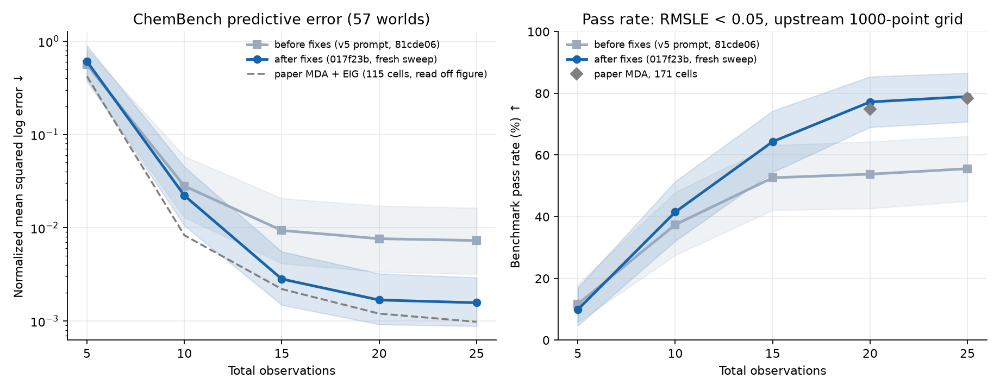

# ChemBench replication

We ran the paper's main ChemBench experiment end to end: all 57 worlds × 3 seeds (171 cells), 22 adaptive experiments each, GPT-5.6 Luna at medium reasoning effort. After fixing two bugs in this repository, the result matches the paper.

## Result

| Observations | Before fixes | After fixes | Paper |
|---|---|---|---|
| 10 | 37.4% | 41.5% | — |
| 15 | 52.6% | 64.3% | — |
| 20 | 53.8% | **77.2%** | 74.9% |
| 25 | 55.6% | **78.9%** (135/171) | 78.4% |
| nMSLE at 25 | 0.0073 | **0.0016** | ≈0.0010 |

- Pass rate at 25 observations has a 95% interval of 70.8–86.5% (world bootstrap). The paper's 78.4% is inside it.
- In-library worlds pass 27/27, as in the paper. Out-of-library worlds pass 108/144.
- Paired against the run before the fixes, the pass rate rose 23.4 points (95% CI +14.6 to +31.6) and nMSLE fell to 0.31× (0.19–0.49).
- nMSLE is still about 1.6× the paper's value read off its figure.

## Protocol

- **Code:** `main` at [`017f23b`](https://github.com/sunxd3/mda/commit/017f23beac114093ba95b8c65a0455b7831d59bd); upstream LLM-AutoSciLab at `9a37255`.
- **Command, per cell:** `mda-reproduce chemistry --world WORLD --seed SEED --live --budget 22`, with an empty response cache.
- **Pass:** RMSLE < 0.05 on upstream `evaluate_law`'s fixed 1000-point grid, as in v5. Every scored snapshot was re-evaluated with upstream code and checked against the run's stored RMSLE (855 of 855 matched).
- **nMSLE:** averaged over seeds within a world, then geometric mean over worlds.
- **Runs:** all 171 completed 22 of 22. Four first attempts failed with transient OpenAI 503 errors and passed on retry.
- **Cost:** about 2 cents of API calls per cell, so a few dollars for the sweep. Each cell takes 1–50 minutes of CPU, mostly BIC fitting.

## What closed the gap

The first full sweeps passed 55–60%. Swapping in the paper's published prompt did not help (−4.7 points, not significant). A fixed nine-law control with no LLM passed 31.6% at 15 observations, matching the paper's fixed arm (about 32%), so scoring, fitting, and experiment design were not the problem. Refitting the true law to each failing run's own data passed in 138 of 140 failures: the data were good enough, but the right law was never proposed.

Two bugs starved the LLM search ([PR #8](https://github.com/sunxd3/mda/pull/8)):

1. **Valid laws were thrown away.** Any law with a lower parameter bound of 0 was dropped. The LLM routinely writes activation energies as `Ea ∈ [0, …]`, so 65% of expansion proposals were discarded, mostly in the `*_arrhenius` worlds. Such bounds are now raised to 10⁻⁶ of the upper bound.
2. **Repeated prompts got the same answer.** When an expansion added nothing, the next prompt was identical, and the response cache returned the same reply. The search stalled after a few rounds. A repeated request is now a fresh draw.

A third bug, an output-token cap that truncated long reasoning and aborted runs, was fixed earlier ([PR #7](https://github.com/sunxd3/mda/pull/7)).

## What still fails

36 cells fail at 25 observations:

- **Allosteric activation** (`c67`, `c78`, `c92`): 0 of 9 pass, with RMSLE 0.3–1.2. The search never finds this form.
- **Near misses:** 16 cells with RMSLE between 0.05 and 0.1, spread across families; sinh worlds are the largest group (5).
- **Wrong laws:** the other 11, such as `c61_sinh_product_arrhenius` (all three seeds) and two seeds of `c39_hill_competitive_arrhenius`.

## Limits

- One sweep, one seed of LLM randomness per cell. A rerun will differ by a few cells.
- The paper does not say how it handled 0 bounds; repairing them is our choice.
- Other known differences are listed under [ChemBench](benchmarks/chembench.md#differences-from-the-paper). Only ChemBench has been swept; GlucoseBench, NeuronBench, and BoxingGym have not.
