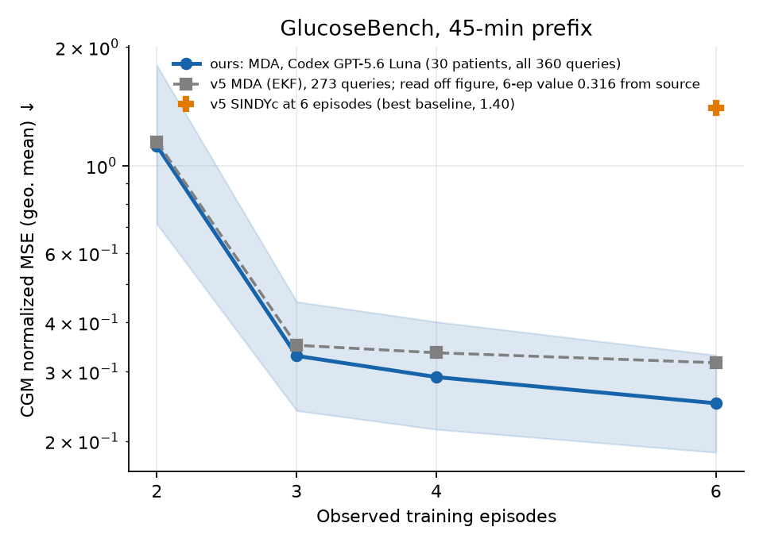
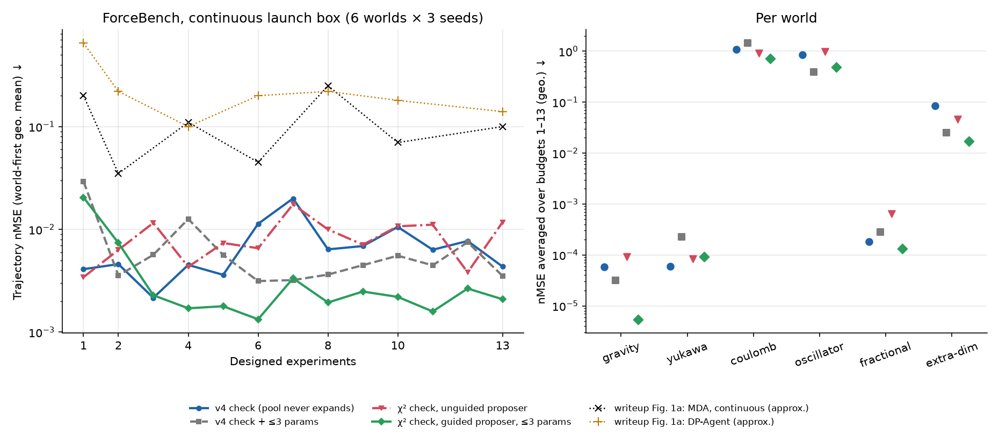

# Replication

We have run two of the paper's main benchmarks end to end with live LLM calls. Both match the paper. NeuronBench and BoxingGym have not been swept. We also ran ForceBench, which v5 dropped, against the continuous-action setup of a later physics writeup.

- [ChemBench](#chembench): 78.9% pass rate at 25 observations (paper 78.4%).
- [GlucoseBench](#glucosebench): CGM nMSE 0.25 after six episodes (paper 0.316), with Codex as the LLM.
- [ForceBench, continuous design](#forcebench-continuous-design): nMSE 0.004 at 13 experiments (writeup ≈0.10), but the model pool never expands; a guided expansion arm lowers error about 2× over the learning curve.

## ChemBench

We ran the paper's main ChemBench experiment end to end: all 57 worlds × 3 seeds (171 cells), 22 adaptive experiments each, GPT-5.6 Luna at medium reasoning effort. After fixing two bugs in this repository, the result matches the paper.

### Result

| Observations | Before fixes | After fixes | Paper |
|---|---|---|---|
| 10 | 37.4% | 41.5% | — |
| 15 | 52.6% | 64.3% | — |
| 20 | 53.8% | **77.2%** | 74.9% |
| 25 | 55.6% | **78.9%** (135/171) | 78.4% |
| nMSLE at 25 | 0.0073 | **0.0016** | ≈0.0010 |

- Pass rate at 25 observations has a 95% interval of 70.8–86.5% (world bootstrap). The paper's 78.4% is inside it.
- In-library worlds pass 27/27, as in the paper. Out-of-library worlds pass 108/144.
- Paired against the run before the fixes, the pass rate rose 23.4 points (95% CI +14.6 to +31.6) and nMSLE fell to 0.31× (0.19–0.49).
- nMSLE is still about 1.6× the paper's value read off its figure.

### Protocol

- **Code:** `main` at [`017f23b`](https://github.com/sunxd3/mda/commit/017f23beac114093ba95b8c65a0455b7831d59bd); upstream LLM-AutoSciLab at `9a37255`.
- **Command, per cell:** `mda-reproduce chemistry --world WORLD --seed SEED --live --budget 22`, with an empty response cache.
- **Pass:** RMSLE < 0.05 on upstream `evaluate_law`'s fixed 1000-point grid, as in v5. Every scored snapshot was re-evaluated with upstream code and checked against the run's stored RMSLE (855 of 855 matched).
- **nMSLE:** averaged over seeds within a world, then geometric mean over worlds.
- **Runs:** all 171 completed 22 of 22. Four first attempts failed with transient OpenAI 503 errors and passed on retry.
- **Cost:** about 2 cents of API calls per cell, so a few dollars for the sweep. Each cell takes 1–50 minutes of CPU, mostly BIC fitting.

### What closed the gap

The first full sweeps passed 55–60%. Swapping in the paper's published prompt did not help (−4.7 points, not significant). A fixed nine-law control with no LLM passed 31.6% at 15 observations, matching the paper's fixed arm (about 32%), so scoring, fitting, and experiment design were not the problem. Refitting the true law to each failing run's own data passed in 138 of 140 failures: the data were good enough, but the right law was never proposed.

Two bugs starved the LLM search ([PR #8](https://github.com/sunxd3/mda/pull/8)):

1. **Valid laws were thrown away.** Any law with a lower parameter bound of 0 was dropped. The LLM routinely writes activation energies as `Ea ∈ [0, …]`, so 65% of expansion proposals were discarded, mostly in the `*_arrhenius` worlds. Such bounds are now raised to 10⁻⁶ of the upper bound.
2. **Repeated prompts got the same answer.** When an expansion added nothing, the next prompt was identical, and the response cache returned the same reply. The search stalled after a few rounds. A repeated request is now a fresh draw.

A third bug, an output-token cap that truncated long reasoning and aborted runs, was fixed earlier ([PR #7](https://github.com/sunxd3/mda/pull/7)).

### What still fails

36 cells fail at 25 observations:

- **Allosteric activation** (`c67`, `c78`, `c92`): 0 of 9 pass, with RMSLE 0.3–1.2. The search never finds this form.
- **Near misses:** 16 cells with RMSLE between 0.05 and 0.1, spread across families; sinh worlds are the largest group (5).
- **Wrong laws:** the other 11, such as `c61_sinh_product_arrhenius` (all three seeds) and two seeds of `c39_hill_competitive_arrhenius`.

### Limits

- One sweep, one seed of LLM randomness per cell. A rerun will differ by a few cells.
- The paper does not say how it handled 0 bounds; repairing them is our choice.
- Other known differences are listed under [ChemBench](benchmarks/chembench.md#differences-from-the-paper).

## GlucoseBench

We ran GlucoseBench for all 30 virtual patients, one run each as in v5: two initial episodes, four selected experiments, and forecasts of the 12 sealed interventions after a 45-minute prefix. The LLM was GPT-5.6 Luna at medium effort through Codex (`--provider codex`), not the direct API. The result matches the paper's MDA curve.

### Result

Patient-level geometric means of training-variance-normalized MSE, pooled over observations after the cut, with 95% patient-bootstrap intervals:

| Training episodes | CGM (ours) | CGM (v5 MDA) | Insulin (ours) | Insulin (v5 MDA) |
|---|---|---|---|---|
| 2 | 1.12 [0.71, 1.80] | ≈1.15 | 0.20 [0.16, 0.25] | — |
| 3 | 0.33 [0.24, 0.45] | ≈0.35 | 0.19 [0.15, 0.24] | — |
| 4 | 0.29 [0.21, 0.40] | ≈0.34 | 0.19 [0.15, 0.24] | — |
| 6 | **0.25** [0.19, 0.33] | **0.316** | **0.19** [0.15, 0.23] | **0.216** |

- The v5 values at six episodes are stated in the paper's source; the others are read off its figure.
- Every v5 value lies inside our interval. Ours run slightly lower, which fits scoring all 360 patient–query pairs: v5 reports 0.304 on the 359 pairs valid at this cut and 0.316 on the 273 valid for every method and cut.
- MDA's CGM error is about 5× lower than v5's best baseline (SINDYc, 1.40) and 24× lower than the persistence baseline (5.97). We did not run SINDYc, ARX, VARX or ICL, so the paper's finding that SINDYc predicts insulin better (0.151) is untested here.
- No forecast failed. 27 of 30 runs added LLM-proposed models; children needed the most (3.2 expansions on average, against 1.5 for adolescents and 1.3 for adults).

### Protocol

- **Code:** `main` at [`c6334e4`](https://github.com/sunxd3/mda/commit/c6334e4c13823b68847c1b34d3c40f361a7628c9); `glucosebench` at `6bb0ff6`.
- **Command, per patient:** `mda-reproduce glucose --world PATIENT --live --budget 4 --provider codex`, with an empty response cache.
- **Codex:** the client switches off Codex's own instructions, tools and environment text, so each call sends only the benchmark's system prompt, the data, and the output schema ([coding-agent clients](library.md#coding-agent-clients)).
- **Runs:** all 30 completed 4 of 4 experiments on the first attempt. Runs take 6–40 minutes of CPU, mostly fitting; Codex is called 0–5 times per patient.

### Limits

- One run per patient, so the interval reflects variation across patients, not LLM randomness.
- Codex wraps the request differently from the direct API (the system prompt is a developer message), so this is not the paper's exact client.
- Only the 45-minute cut was compared; v5 also reports cuts at 0, 120 and 180 minutes. Other differences are listed under [GlucoseBench](benchmarks/glucosebench.md).

## ForceBench, continuous design

v5 dropped ForceBench. A later writeup by the authors (not on arXiv) reran it with MDA and the DiscoverPhysics agent (DP-Agent) in the same continuous launch box, instead of v4's 13-action menu, and found the gap between them small (paired loss ratio 0.58, 95% CI [0.10, 3.15]). Its explanation is that the menu leaked which experiments are informative. We replicated the MDA side and then tested a competing explanation: that MDA explores model space too little. VoI only values experiments on which the models already in the pool disagree. If every candidate shares the same mistake, the experiment that would expose it scores zero, is never run, and nothing pushes the agent to a structurally new law.

### Result

Four arms, 6 worlds × 3 seeds each, 13 designed experiments, all 72 runs complete. All arms replay the same 18 initial LLM pools and make the same first design, so within a world and seed the arms differ only in the listed setting.

| Arm | Check | Proposer | Expansions per run | nMSE at 13 | nMSE over 1–13 |
|---|---|---|---|---|---|
| Replication | v4 (τₑ = 1.4) | v4 prompt | 0 | 0.0043 | 0.0061 |
| Cap only | v4 | v4 prompt, ≤3 parameters | 0 | 0.0035 | 0.0055 |
| χ² | χ² on fresh trajectory | v4 prompt | 7.9 | 0.0117 | 0.0077 |
| Guided | χ², ≤1 expansion per experiment | shows misfit, ≤3 parameters | 7.8 | **0.0021** | **0.0027** |

nMSE is the world-first geometric mean (seeds within a world, then worlds). The writeup's MDA reaches about 0.10 at 13 experiments and DP-Agent about 0.14 (read off its Fig. 1a).

Paired ratios, world-first, with 95% world-bootstrap intervals:

| Comparison | At 13 | Over 1–13 | Lower on |
|---|---|---|---|
| χ² ÷ replication | 2.70 [1.41, 4.73] | 1.27 [0.82, 2.03] | 1/6 worlds at 13 |
| Cap only ÷ replication | 0.81 [0.24, 3.47] | 0.91 [0.48, 1.84] | 3/6 over the curve |
| Guided ÷ replication | 0.48 [0.09, 1.87] | **0.45 [0.21, 0.88]** | 5/6 over the curve |
| Guided ÷ cap only | 0.59 [0.15, 2.39] | **0.49 [0.30, 0.78]** | 5/6 over the curve |
| Guided ÷ χ² | **0.18 [0.05, 0.51]** | **0.35 [0.15, 0.72]** | 6/6 at 13 |

Per world, averaged over budgets 1–13:

| World | Replication | Cap only | χ² | Guided |
|---|---|---|---|---|
| gravity | 5.8e-5 | 3.1e-5 | 9.3e-5 | **5.5e-6** |
| yukawa | **6.0e-5** | 2.3e-4 | 8.4e-5 | 9.3e-5 |
| coulomb | 1.1 | 1.4 | 0.91 | **0.72** |
| oscillator | 0.85 | **0.39** | 0.99 | 0.49 |
| fractional | 1.8e-4 | 2.8e-4 | 6.4e-4 | **1.3e-4** |
| extra-dim | 0.084 | 0.025 | 0.047 | **0.017** |

### What the runs show

1. **v4's check never fires, so the pool is frozen.** It needs the median relative position error over the fresh and every stored trajectory to exceed 140%. In all 36 runs with this check (replication and cap only), it fired 0 times and the 24-law pool from the seed drop never changed. v5 notes that the median can delay expansion; with τₑ = 1.4 the delay is permanent. It also says the executed DP agent used this kind of gate, so the writeup's runs were likely frozen too, but we have not seen its code or logs.
2. **A frozen pool still predicts well here.** Our replication is about 20× below the writeup's MDA overall and avoids its oscillator blow-up. Yukawa reaches 6e-5 without ever containing the true K₁(r/λ)/λ kernel, because near-equivalent screened laws match it on the held-out launches.
3. **Letting expansion fire is not enough.** The χ² arm spends its 8 expansions within the first 4–7 experiments, after which large misfits go unanswered, and the LLM adds terms rather than changing structure: its final laws average 5.3 free parameters against 2.9 in the replication, with time modulation, softening and oscillating corrections. It ends 2.7× worse than the replication.
4. **Guided expansion helps.** Showing the proposer the current best law, its misfit on every experiment in units of σ, and the latest trajectory observed against predicted, asking for structurally different laws, capping laws at 3 parameters, and allowing one expansion per experiment gives about half the replication's error over the learning curve. The parameter cap alone does not account for it: guided beats cap only over the curve on 5 of 6 worlds.
5. **The designs did expose misfit, but only for the pools we had.** Under the χ² arm, 64% of designed experiments failed the check and 31% missed the MAP prediction by more than 100× the 99% noise quantile. Every one of the 454 laws in the 18 initial pools used both charges, and the pools mixed radial forms, so the shared-mistake case was never set up. These runs neither confirm nor refute that VoI gets stuck when every candidate shares a mistake.

### What still fails

- **No arm recovered the exact law** on yukawa, oscillator or extra-dim. Guided yukawa seed 1 ended on the textbook Yukawa, exp(−λr)/rⁿ, not the K₁ kernel; gravity and fractional end on softened 1/r and 1/r² laws that are equivalent within the noise.
- **Oscillator's sign-reversing coupling, cos(ωt + φ)/r, was never proposed.** Guided runs tried exp(−λrt) and 1 − (t/τ)² instead.
- **Late single proposals still blow up.** Guided ends at 8.0 on oscillator seed 1 and 31.6 on extra-dim seed 0, so its final-point ratios have wide intervals.

### Protocol

- **Code:** `main` at [`306acc5`](https://github.com/sunxd3/mda/commit/306acc5) plus this change; DiscoverPhysics at `33b7fa9`.
- **Settings:** the continuous box and integrator of [ForceBench](benchmarks/forcebench.md#continuous-design-and-the-expansion-check); otherwise v4's ForceBench settings (pool 24, 6 proposals per expansion, 60 SMC particles, Occam penalty 2.5, σ = 0.05, seed drop at r = 3).
- **Command, per cell:** `mda-reproduce physics --world WORLD --seed SEED --live --provider codex --budget 13 --design-space continuous` plus `--check chi2`, `--check guided --max-params 3`, or `--max-params 3` for the other arms.
- **LLM:** GPT-5.6 Luna at medium effort through Codex. The initial proposal for each world and seed was generated once and replayed by all arms.
- **Runs:** 72 of 72 completed 13 of 13, with no failed predictions and no reruns. Each takes 25–45 minutes of CPU.

### Limits and next steps

- Three seeds per world and one LLM draw per run. The guided arm changes the prompt and the expansion schedule together.
- There is no DP-Agent harness here, so these runs do not measure the MDA–DP-Agent gap; our MDA differs from the writeup's (proposer prompt, optimizer implementation) in ways we cannot pin down.
- The direct test of the shared-mistake mechanism is a fixed pool of charge-blind laws with expansion off on coulomb, and of short-range power laws on yukawa: compare VoI's maximum over the box with the largest misfit any design would reveal, against the same pool plus the true law.
